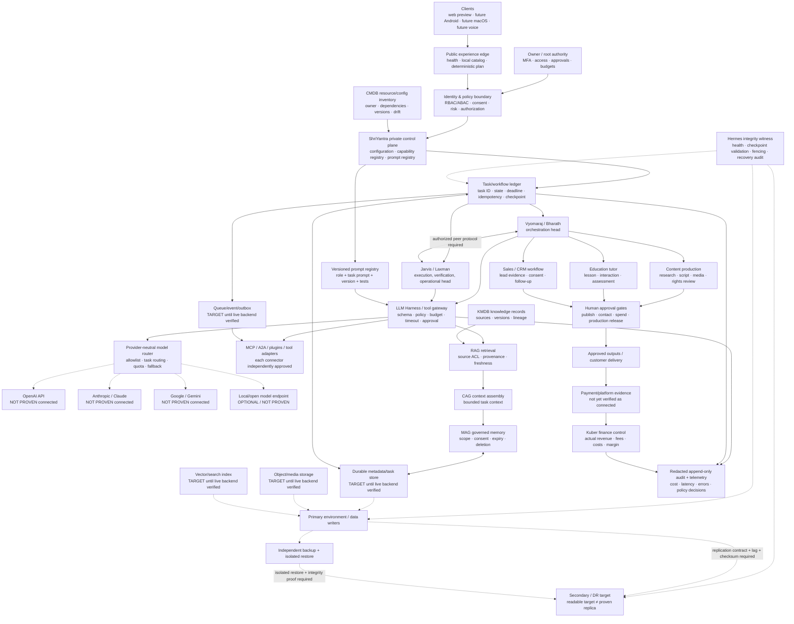
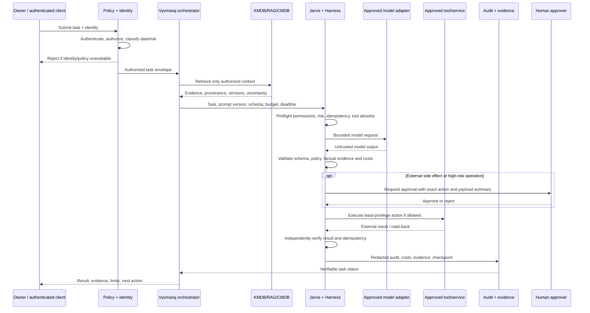

# Vyomaraj + Jarvis — Hard Architecture and Component Process Flows

**Revision:** 2026-10-15  
**Scope:** Consolidated architecture/process map derived from checked-in architecture, prompt/runtime, current-state, revenue-flow, public-preview and DR evidence.  
**Status:** Architecture baseline and implementation inventory; not a claim that every target component is connected or production-ready.

## 1. Architecture truth labels

- **IMPLEMENTED / REPO:** source, test, configuration, or design artifact exists in the repository.
- **LOCALLY TESTED:** offline/local test evidence exists; this does not prove deployment.
- **DEPLOYED / NARROW:** a specifically identified hosted component is live and passed its documented smoke checks.
- **CONNECTED:** a live authenticated dependency has been exercised end to end.
- **NOT PROVEN / BLOCKED:** evidence is missing or a required gate fails. Treat the capability as unavailable for production decisions.
- **TARGET:** planned architecture, not implementation evidence.

Never infer CONNECTED from a package name, prompt, environment example, diagram, catalog entry, Git tree match, or passing offline test.

## 2. Hard architecture — control plane, agents, providers, data and business

**Diagram legend:** solid arrows are intended logical request/data flow; dotted arrows are optional, target, or not-yet-proven connections. The live public preview currently represents only the narrow edge behavior described in Section 3. This diagram is a hard architecture target with explicit truth labels, not a production topology assertion.

## 3. Components and evidence inventory

| Component | Responsibility / input → output | Current evidence boundary |
|---|---|---|
| GitHub primary repository | source, prompt definitions, tests, workflows, architecture docs | Repository and CI workflows exist; code continuity is not runtime continuity |
| Public web preview on Render | HTTP health, local catalog, deterministic planning response | Deployed and narrowly smoke-tested; not the private control plane or production |
| GitHub Pages / static client assets | static site/PWA assets and offline shell | Repository artifacts exist; not proof of authenticated control-plane access |
| ShriYantra | policy, identity, approvals, configuration, task routing | Target architecture; complete live enforcement not proven |
| Vyomaraj / Bharath | task decomposition, orchestration, prioritization | Role/code references exist; fully connected autonomous production head not proven |
| Jarvis / Laxman | execution coordination, tests, health and recovery support | Harness/role files and local tests exist; live peer runtime and production heartbeat not proven |
| Hermes | integrity evidence, peer health, fencing and recovery audit | Architectural role; independent production witness not proven |
| Prompt registry | versioned task presets, roles, schema and regression tests | Prompt runtime work exists in PR #61, which must be independently merged/verified before mainline adoption; provider still requires configuration |
| LLM harness | explicit model invocation boundary | Provider-neutral harness exists; no live provider is certified by this document |
| OpenAI / ChatGPT | API model calls or separately designed ChatGPT product integrations | ChatGPT product, custom GPT/Actions/connectors, and OpenAI API are distinct; API connection not proven |
| Claude / Anthropic | provider adapter/model calls | Dedicated live adapter, credentials, smoke and failure tests not proven |
| Gemini | provider adapter/model calls | Dedicated live adapter, credentials, smoke and failure tests not proven |
| MCP / A2A / plugins | delegated tools and service-to-service tasks | Must inventory each endpoint and permission; no blanket plugin connectivity claim |
| RAG / CAG / MAG | authorized retrieval, bounded context, governed memory | Design and documents exist; complete durable live data path not proven |
| KMDB | knowledge sources, provenance, versions, freshness and retention | Durable connected backend and restore not proven |
| CMDB | service/resource inventory, ownership, dependencies, configuration drift | Authoritative live inventory and drift automation not proven |
| Arena | delegated execution via validated task envelope | Adapter/architecture references exist; production runtime connection not proven |
| Content agents | researched scripts, plans, media briefs and distribution packages | Deterministic local planning/catalog behavior exists; live generative/media/publishing chain not proven |
| Education agent | adaptive explanation, exercises, assessment and feedback | Prompt templates can be used manually; deployed tutor runtime and learner-data store not proven |
| Sales agent | qualified lead research, outreach drafts, pipeline and follow-up | Prompt workflow available as design; CRM, consent-aware outreach, payment and actual conversion not proven |
| Kuber | actual revenue/cost reconciliation, invoices, ROI and margin | Finance role defined; live accounting/payment data connection not proven |
| Primary/secondary Git | versioned source synchronization and integrity checks | Guarded workflows and historical matching-tree evidence exist; current authorized write/read-back is not proven |
| Runtime/data DR | persistent database/object/queue/audit replication and recovery | Not proven; Git replication alone is insufficient |
| Backup/restore | recover data and service state independently | End-to-end isolated restore proof not established |
| Android | signed app package and device client | APK artifact exists; source provenance, signature, device tests and release pipeline not established |
| macOS | signed/notarized native client | Native source/build/signing and release evidence not established |
| CI/test/observability | automated checks, test evidence, logs, alerting and release gates | CI workflows and local test records exist; every production SLO/alert not proven |
| Security | identity, least privilege, secret handling, rate limits, abuse protection and audit | Several local safeguards/tests exist; production identity and full security posture remain incomplete |

## 4. Shared task execution process — exact logical sequence

**Fail-closed points:** unknown identity; missing policy; invalid task envelope; unapproved external side effect; unavailable mandatory audit; schema failure; excessive budget; failed independent verification; unsafe replication/fencing state. A model's statement that an action succeeded is not proof.

## 5. Process flow per business/technology lane

### A. AI providers and prompt runtime
1. Select a specific task, privacy class, model and cost/latency budget.
2. Load a versioned user-owned prompt; validate schema and role permissions.
3. Route only to an approved provider adapter with a secret-manager reference.
4. Enforce timeout, rate limit, budget, data redaction and response schema.
5. Record provider/model version, token/cost estimates, latency, outcome and redacted evidence.
6. Test provider failure and fallback. Do not repeat side effects; model retries are bounded and idempotent.
7. Add Claude/Gemini/other models only after independent adapter tests.

### B. MCP / A2A / plugins / tools
1. Register connector ID, owner, official endpoint, auth method and exact scopes.
2. Classify data sent/received; assess tool output as untrusted.
3. Use dry-run and schema validation; require human approval for high-impact actions.
4. Execute with least privilege, bounded timeout and idempotency key.
5. Independently read back state; audit result and cost.
6. Disable the connector safely if health, authorization, budget or integrity fails.

### C. KMDB / CMDB / RAG / CAG / MAG
1. Ingest only approved sources with source ID, owner, timestamp, license/consent and content hash.
2. Parse, redact, classify and index; preserve source ACLs.
3. Retrieve with identity-aware filtering and provenance; quarantine prompt-injection content.
4. Assemble bounded context: trusted policy first, task brief, authorized evidence and approved memory.
5. Store memory only under explicit scope, retention, validation and deletion rules.
6. Propagate corrections/deletions through derived indexes; verify stale data cannot be retrieved.
7. Back up and restore metadata, raw sources, indexes or rebuild instructions, and ACLs.

### D. Primary / secondary / backup / DR
1. Identify the exact source and destination; pin writer identity and permitted paths.
2. Verify destination baseline and policy; review delete/overwrite semantics.
3. Write a unique non-destructive canary to the authorized durable store.
4. Read the canary back independently from the destination; compare value and checksum.
5. Measure replication lag, consistency and data-loss window; record evidence.
6. Restore an independent backup into an isolated environment and run integrity/application tests.
7. Rehearse failover with writer fencing, health/quorum checks and owner approval.
8. Rehearse failback only after reconciliation, checksum agreement and explicit gates.
9. Abort on unknown target, stale evidence, split-brain risk or mismatch. Do not treat Git commit equality as application-data recovery.

### E. Content and education
1. Define audience, learning/content goal, language, rights and delivery format.
2. Retrieve authorized source material and mark fact/interpretation/uncertainty.
3. Generate script/lesson, examples, visual plan, captions or exercises.
4. Run factual, age-appropriateness, accessibility, privacy, cultural and copyright checks.
5. Human reviewer approves public content; teachers validate learning resources.
6. Publish only through authorized connectors and collect aggregate outcome metrics.
7. Improve by measured completion, retention and learning outcomes—not vanity metrics alone.

### F. Sales and Kuber finance
1. Define one offer, ideal buyer, problem, price, cost-to-serve and proof.
2. Research prospects using lawful/authorized data; verify evidence and contact permission.
3. Draft personalized outreach; respect consent and opt-out.
4. Require approval before sending, quoting, signing, or spending.
5. Track lead → qualified → meeting → proposal → won/lost with reason and timestamps.
6. Reconcile actual receipts/refunds/platform fees against invoices and accounting records.
7. Calculate contribution margin, acquisition cost, payback and retention only from actual data.
8. Scale the offer only after repeatable paid demand and acceptable margins are demonstrated.

### G. Deployments and clients
1. Pin source commit, dependencies, build artifact and environment.
2. Run unit/integration/security checks and produce build provenance/SBOM where feasible.
3. Deploy to preview/staging, run smoke and negative authorization tests.
4. Validate secrets are referenced securely and never printed.
5. Require owner approval and rollback readiness before production release.
6. Monitor health, latency, errors, cost, queue lag and alerts after deployment.
7. Android: prove source-to-APK provenance, signing, permissions, install/update and device tests.
8. macOS: prove native build, signing/notarization, permissions, installation/update and device tests.

## 6. Primary and secondary: distinct layers, distinct evidence

- **Git/source DR:** branches, commits, tree hashes, artifacts, workflow logs. Proves code-version continuity only.
- **Configuration DR:** versioned non-secret config and secret-manager references, with environment-specific differences documented.
- **Application data DR:** SQL/object/vector/queue/task/audit/memory data and schema compatibility. Requires replication or backup evidence for each store.
- **Identity/security DR:** issuer, keys/certificates, access policy, audit continuity, revocation and owner recovery.
- **Runtime DR:** deployable artifacts, compatible dependencies, service health, routing, DNS, worker capacity and safe start/stop.
- **Recovery proof:** independent read-after-write, checksum, isolated restore, measured RPO/RTO, fencing, failover/failback and audit.

A matching Git tree is not proof that the secondary can serve live traffic or recover user data.

## 7. Scalability and security contracts

- Provider-neutral adapter contract; versioned schemas and compatibility windows.
- Least privilege, secret manager, MFA/passkeys, RBAC/ABAC, consent and action-bound approval.
- Rate limits, budget caps, circuit breakers, bounded retries, queues/back-pressure and dead-letter handling.
- Idempotency for external writes; explicit duplicate suppression and compensation plans.
- Prompt-injection isolation, data redaction, retrieval ACL filtering, provenance and retention/deletion controls.
- Redacted audit trail, metrics, alerts, service inventory, dependency/SBOM review and incident runbooks.
- Separate dev/test/staging/production; signed artifacts, rollback, migration checks and release approval.
- Explicit RPO/RTO targets and scheduled restore/failover drills; do not label “real-time” without a measured lag SLO and independent read-after-write evidence.

## 8. Revenue-first execution lane

Recommended first experiment: sell one clearly scoped service to one narrow buyer segment, deliver it manually with AI assistance, and record actual unit economics. For example, a content-planning package can include original short-video concepts, scripts, captions and a weekly calendar; exclude production/publishing until rights, capacity and approvals are in place.

Funnel: target hypothesis → 10 customer discovery conversations → offer and price test → paid pilot → delivery → customer feedback → renewal decision → margin analysis. The target count is an experiment plan, not evidence of market demand.

Scale only when there is evidence of willingness to pay, repeat demand, delivery quality, positive contribution margin and manageable acquisition cost. Revenue and wealth are not guaranteed by architecture.

## 9. Immediate acceptance gates

- [ ] Review/merge this architecture documentation through required repository gates.
- [ ] Resolve prompt-runtime PR #61 conflict/status; run its required tests; do not assume presets are in main.
- [ ] Confirm owner identity and secret handling; privately inspect tracked legacy environment files.
- [ ] Configure and smoke-test one approved model provider.
- [ ] Prove one protected tool call with independent read-back and redacted audit.
- [ ] Establish KMDB/CMDB persistence and access-filtered retrieval.
- [ ] Establish per-store backup/restore and measured DR.
- [ ] Complete a paid pilot and reconcile actual revenue/costs before scaling.
- [ ] Verify Android/macOS source, signatures and device release checks.

**Release verdict:** public preview narrowly deployed; several useful code/docs/tests exist; full AI integration, private production control plane, durable KMDB/CMDB, real-time application sync, end-to-end DR, and a live money-generating system remain NOT PROVEN until their individual gates pass.
